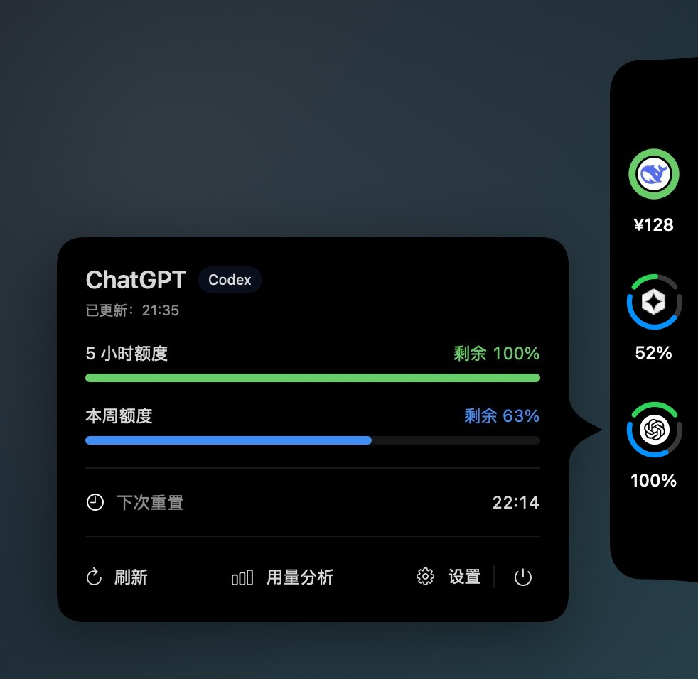
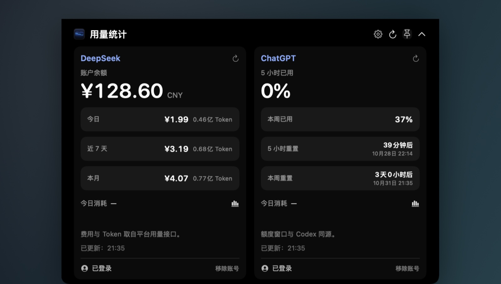
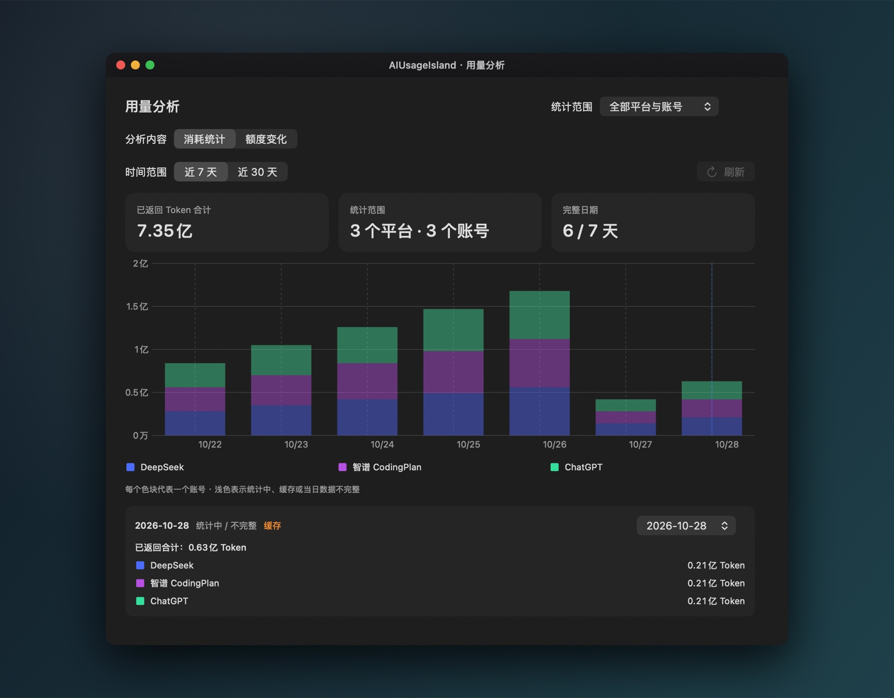

# AIUsageIsland

macOS 14+ 菜单栏／侧边停靠的 AI 用量与额度工具，支持 DeepSeek、智谱 CodingPlan、ChatGPT/Codex、OpenCode Go。

[](https://github.com/gReyWangP/AIUsageIsland-releases/releases/latest)
[](LICENSE)
[](#系统要求)
[](Package.swift)

当前版本：2.1.0（build 83）。

[下载最新版](https://github.com/gReyWangP/AIUsageIsland-releases/releases/latest) · [更新说明](CHANGELOG.md) · [贡献](CONTRIBUTING.md) · [问题反馈](https://github.com/gReyWangP/AIUsageIsland/issues) · [隐私](PRIVACY.md) · [安全策略](SECURITY.md) · [第三方声明](THIRD_PARTY_NOTICES.md) · [MIT License](LICENSE)

## 功能

- 顶部灵动岛、悬浮状态栏、侧边停靠三种显示形式。
- 多平台、多账号的额度／余额、重置时间、用量分析与历史记录。
- OpenCode Go 5 小时／本周／本月三窗口额度监控；使用官方 Console 的 Go API Key。
- 侧边停靠跟随显示账号，支持上下自由拖动、双额度环和可调圆弧。
- 切换外接屏时保持所选屏幕，设置页屏幕列表随插拔刷新。
- 本机提醒、Bark 公开重置动态推送与 Sparkle 应用内更新。

## 界面预览


*侧边停靠：5 小时／本周双额度环，以及指向当前图标的引出尖角详情卡片。*

| 顶部灵动岛 | 悬浮状态栏 |
| --- | --- |
|  |  |


*用量分析：全部平台与账号的每日堆叠柱状图与明细。*

> 截图使用演示数据，不含真实账号、凭据或敏感信息。

## 系统要求

macOS 14 及以上，Apple Silicon。从源码构建需要 Xcode 16 / Swift 6 工具链。

## 下载与安装

从 [公开分发仓库 Releases](https://github.com/gReyWangP/AIUsageIsland-releases/releases/latest) 下载安装 ZIP，退出旧实例后解压替换 `AIUsageIsland.app`；账号与设置保留。安装包使用临时签名，尚未完成 Developer ID 签名和 Apple 公证；首次打开可能被 macOS 阻止，可在“系统设置 → 隐私与安全性”中允许。应用内更新默认不自动检查，可在“设置 → 通用与支持 → 软件更新”中开启。

## 从源码构建

```sh
swift test
./scripts/build-app.sh dist --mode local
./scripts/validate-app.sh dist/AIUsageIsland.app local
```

正式签名／公证模式需要 Developer ID Application 与公证配置，见 [发布步骤](docs/updates-publishing.md)。

## 隐私与安全

账号凭据只保存在本机，没有遥测；详见 [PRIVACY.md](PRIVACY.md)。安全漏洞请通过 GitHub Security Advisories 私下报告，不要在公开 issue 中粘贴 token、Cookie 或账号信息。

## 贡献

欢迎提交 Issue 或 PR。提交前请阅读 [CONTRIBUTING.md](CONTRIBUTING.md)；安全漏洞请按 [SECURITY.md](SECURITY.md) 私下报告。

## 许可证

代码采用 [MIT License](LICENSE)。平台名称与 Logo 归各自权利人所有，仅用于识别；Sparkle 等第三方组件遵循其自己的许可证，见 [THIRD_PARTY_NOTICES.md](THIRD_PARTY_NOTICES.md)。

## 版本记录

### 2.1.0（2026-11-06）

新增 OpenCode Go 订阅额度监控，支持 5 小时／本周／本月三个窗口；侧边停靠新增内嵌本月环的三窗口图标，账号通过官方 Console 的 Go API Key 连接。包含 2.0.3 的外接屏修复；其余功能与 2.0.3 一致，详细变更见 [CHANGELOG.md](CHANGELOG.md)。
